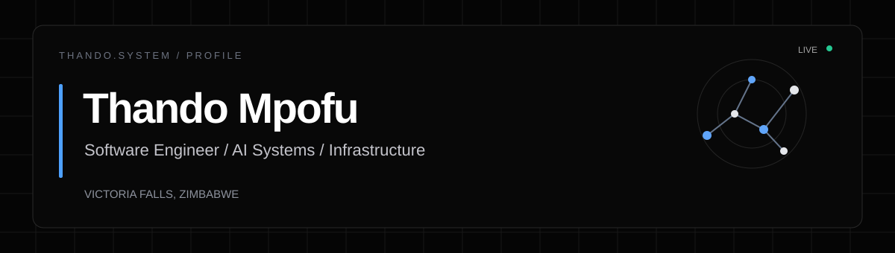

 

**Software Engineer at IT's No Matata** &nbsp;·&nbsp; Victoria Falls, Zimbabwe

Building full-stack applications, infrastructure systems, and experimental language models.

 

---

### `01 / ABOUT`

I design and develop software across **web, mobile, backend, and infrastructure**. My work combines product engineering with a growing interest in **language-model training, evaluation, and efficient inference**.

I work at **IT's No Matata**. Some projects I contribute to serve external clients, including **Shearwater Victoria Falls**; these are client engagements, **not my employer**. My independent model experiments are separate from client and company systems.

> My approach: understand the system, document the tradeoffs, ship carefully, and keep learning.

### `02 / ENGINEERING FOCUS`

| Area | What I work on |
| :--- | :--- |
| **Product engineering** | React, Next.js, TypeScript, React Native, APIs, and application workflows |
| **Backend & data** | Node.js services, PostgreSQL, authentication, and database-backed systems |
| **Infrastructure** | Linux VPS administration, Docker, deployment workflows, and operational tooling |
| **Language models** | Transformer training, tokenization, evaluation, and inference optimization experiments |
| **Design & experience** | Figma-led interfaces, accessible UI, and clean product presentation |

### `03 / SELECTED WORK`

<table>
<tr>
<td width="50%" valign="top">

**Shearwater Operations Platform**  
`PROFESSIONAL · IN PROGRESS`

Multi-portal operations and agent workflows for a tourism client, developed through **IT's No Matata**.

*Client project — internal source and architecture details are not public.*

</td>
<td width="50%" valign="top">

**VPS Admin Control**  
`ENGINEERING · IN DEVELOPMENT`

An administrative interface exploring secure server status, infrastructure visibility, and operational workflows.

*Development project; not presented as production-ready.*

</td>
</tr>
<tr>
<td width="50%" valign="top">

**Custom 14.5M Language Model**  
`RESEARCH · EXPERIMENTAL`

Training and evaluating a small transformer language model to investigate data, tokenization, model behavior, and optimization.

*Experimental research; capabilities are under evaluation.*

</td>
<td width="50%" valign="top">

**ModelPack**  
`RESEARCH · EXPLORATORY`

Investigating memory-efficient model packaging and inference on resource-constrained computers.

*Research goal, not a claim of achieved compression performance.*

</td>
</tr>
</table>

Explore more context and case studies at **[thandom.tech](https://thandom.tech)**.

### `04 / TOOLS & TECHNOLOGIES`

**Building with**

  &nbsp;
  &nbsp;
  &nbsp;
  &nbsp;
  &nbsp;
  &nbsp;
  &nbsp;
  &nbsp;
  &nbsp;
  &nbsp;
  

**Also working with / exploring**  
React Native · Expo · SQLite · MySQL · C · C++ · Rust · Kubernetes · Adobe creative tools · Sony camera workflows

**Currently learning and deepening**  
Microsoft Azure · Java · CCNA networking · DevOps practices · Kubernetes and orchestration

> These are not all equivalent proficiency claims. The list distinguishes technologies used in projects from those under exploration or study.

### `05 / RESEARCH NOTES`

My current interests include:

- Training and diagnosing smaller transformer language models.
- Measuring model behavior rather than relying only on generated samples.
- Exploring memory and inference constraints on older CPUs.
- Building understandable, auditable infrastructure tooling.

I aim to share reproducible experiments and findings when they're ready to publish.

### `06 / CONNECT`

**Portfolio:** [thandom.tech](https://thandom.tech)  
**GitHub:** [github.com/thando544](https://github.com/thando544)

  Designed with the same principles as my portfolio: clarity, systems thinking, and restraint.

